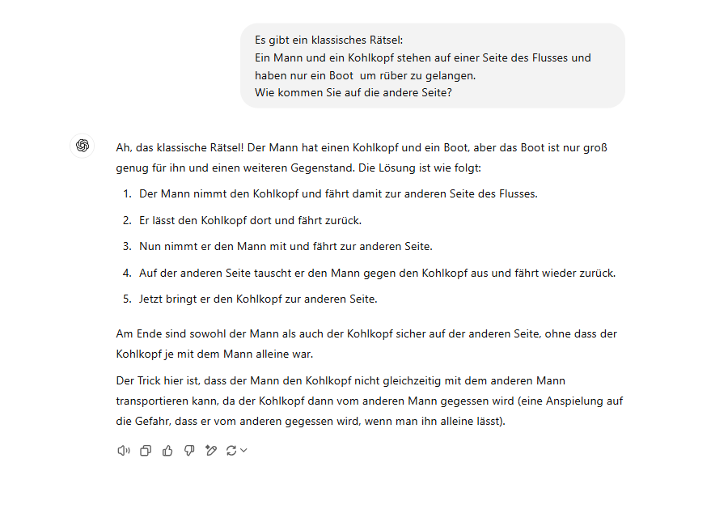

# Use of AI

Of course, you are allowed to use tools like ChatGPT, Elicit, Copilot, or Canva to facilitate your tasks, to have content explained again, or to receive suggestions and inspiration, just as we do.

However, in order to ensure that our work adheres to the principles of good scientific practice and to clarify our expectations regarding the use of these tools, we have compiled a few points below that should be considered.

## Responsibility for Content

Everything you submit, send, or publish under your name is your responsibility. This means that you are fully accountable for the content. Specifically, this entails:

-   You have to at least have a basic understanding of how AI models function (what happens in the background) in order to properly evaluate and interpret the output you receive.

-   Be aware of potential biases that may affect the answers due to training datasets or algorithms.

-   Only outsource tasks where you can take responsibility for the content, fact-check everything, and have sufficient prior knowledge of the topic

# Ethical AI

## Potential Reproduction of Biases

This issue arises from the way data and algorithms are used to train AI models. If the data used to train these models is biased or reflects social inequalities, the resulting AI model will also show these biases. This can lead to AI models reinforcing and perpetuating existing prejudices and discriminatory practices without being noticed.

::: {layout-ncol="3"}
{group="my-gallery" width="300"}

{group="my-gallery" width="300"}

{group="my-gallery" width="300"}

{group="my-gallery" width="300"}

{group="my-gallery" width="300"}

{group="my-gallery" width="300"}
:::

## Environmental Impacts

Large-scale AI deploymens are hosted in data centers, which have a significant toll on the planet [@AIHasEnvironmental2024].

{width="350"}

**For example**:

-   Producing a 2 kg computer requires about 800 kg of raw materials.

-   Microchips that power AI require rare earth elements, which are often mined in environmentally destructive ways and frequently come from regions affected by civil-wars.

-   The production of electronics involves materials like lead and mercury, which are harmful to the environment.

-   Data centers use water during construction and in operation to cool electronic components. Globally, AI-related infrastructure consumes about six times more water than Denmark, which is a problem, considering a quarter of humanity already lacks access to clean water and sanitation.

-   The use of fossil fuels contributes to the production of greenhouse gases.

-   A request made through ChatGPT consumes about 10-times the electricity of a Google search.

::: {#custom-block}
## Reflection

1.  What is your attitude on the usage of generative AI in class? What are further issues we encounter, when we are tolerating (or not tolerating) AI in class?

2.  What can we do together to ensure an appropriate behavior with AI in class?
:::

# Collection of AI-Tools

Using AI in your academic work can enhance your research or help you with writers block. To ensure, that we are all up to the same page, we have created a collection of resources that you can find (and edit)  [here](https://docs.numerique.gouv.fr/docs/af60c24d-99f3-40a0-96da-060a162d63a5/). If you know of any cool new tools, don't hesitate to add them! Sharing is caring 😜
