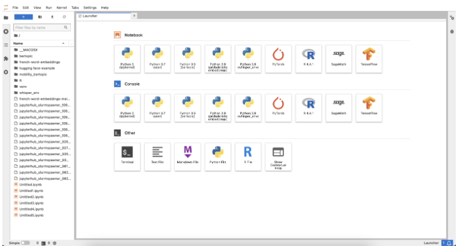
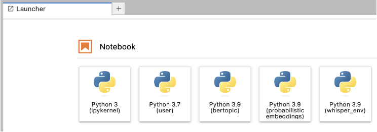

::: callout-note
This document is an updated and extended version of original work by [Felix Lennert](https://felix-lennert.netlify.app/), who has kindly granted us permission to adapt and share it with you.
:::

# Introduction

This document serves as an introduction to working with the Leipzig University Computer cluster. The cluster is available for students and members of Leipzig University. You have to register first and ask for access to different resources, and then once it’s set up, you can use it for your own research purposes. It comes with a large amount of storage for your data. You can work on these using RStudio via a web app (<https://rstudio01.sc.uni-leipzig.de>) and it also provides access to Python via JupyterLab (<https://lab.sc.uni-leipzig.de/>). Furthermore, you can send jobs using Slurm.

## Why Should I Use Scientific Computing?

Using the computational cluster provides numerous advantages, especially when your programs can run independently without supervision and aren't feasible to execute on your local machine. Typical scenarios include:

-   Your script requires a significant amount of time to finish (several hours or even days).

-   Your task demands more RAM than your local computer can provide.

-   Your computation generates a large volume of temporary data that exceeds your local storage capabilities.

-   You need to repeatedly execute the same code across multiple datasets or parameter combinations—especially when the number of runs is very large.

-   You prefer to let your calculations run smoothly in the background, allowing you to enjoy downtime at the park while maintaining the satisfying feeling of productivity!

# Registration and Access Setup

Before utilizing the cluster, you need to register and request access to the necessary resources.

## **Request SC Infrastructure Access:**

To use the SC cluster, first request access:

-   Visit the [Scientific Computing Knowledge Base](https://www.sc.uni-leipzig.de/).

-   Go to **Request SC infrastructure**.

-   Complete the form with your university credentials.. A good start is to ask for *paula, clara, paul, jupyter, rstudio*

Approval typically takes a few hours to days.

## **Accessing the Cluster:**

When accessing the cluster, make sure that you are connected to the university’s internal network (i.e., you are physically in a university building and connected to the local wifi network) or use a VPN ([instructions](https://www.urz.uni-leipzig.de/en/servicedesk-und-hilfe/hilfe-zu-unseren-services/netz-und-zugang/hilfe-vpn-zugang-zum-uni-netz-vpn-webvpn)).

If this is the case, you can access the services through your web browser:

-   **JupyterLab:** [lab.sc.uni-leipzig.de](https://lab.sc.uni-leipzig.de)

-   **RStudio:** [rstudio01](https://rstudio01.sc.uni-leipzig.de), [rstudio02](https://rstudio02.sc.uni-leipzig.de)

For submitting jobs, you need to connect to the cluster from your terminal. To do this, the most convenient way is to authenticate via SSH. SSH gives you the possibility to connect safely to another computer (the server, in our case). Then, once connected, you can control the remote machine via terminal commands. This is good for submitting jobs. Everything else (i.e., interactive coding, code testing, etc.) should be done using the web interface in JupyterLab or RStudio.

Before you can authenticate using SSH, you need to create a key pair on your own machine and upload the public key to the cluster. You can find an extensive tutorial [online](https://www.sc.uni-leipzig.de/03_System_access/Cluster/).

Once you have access, you can connect using your terminal with your SC username.

``` bash
ssh <your_sc_username>@login01.sc.uni-leipzig.de
```

# Workflow

Since the RStudio web app is very similar to the IDE you can run on your own machine, the majority of this chapter will rather focus on the yet unknown – i.e., Python, the terminal, and Slurm jobs. I will first describe where and how you can register for access, then delve into daily Python workflows (i.e., basic terminal commands, authentication, choosing modules, creating project-specific environments, and setting up dedicated kernels), and then finally introduce Slurm which allows you to send “jobs” for more resource-intensive computations that you couldn’t run in a classic Jupyter Notebook.

## Python

Once you have access, you can set up your Python environment and workflows.

When you access [JupyterLab](https://lab.sc.uni-leipzig.de), you first need to choose your server and the resources you need. *paul* has CPUs only, while *clara* and *paula* also have GPUs available.

{#fig-sc-landing-page}

Once you have launched the server, you reach the “Launcher.” While you can do most of these things in the JupyterLab GUI, we recommend using terminal commands since it’s fast and – once you’ve got the hang of it – easier. In the Launcher, you can open a Terminal window by clicking “Other \> Terminal” (see screenshot below).

{#fig-launcher}

### Basic Terminal Commands

Familiarity with basic terminal commands is essential for navigating and managing files on the cluster. Here are some common commands:

-   `ls`: List directory contents.

-   `cd`: Change the current directory, e.g., cd my_folder

-   `pwd`: Display the current directory path.

-   `mkdir`: Create a new directory (make sure you have navigated to the right folder first).

-   `rm`: Remove files or directories, e.g., rm my_file

For a comprehensive list, consult the [Linux Command Reference](https://community.linuxmint.com/tutorial/view/244).

### Module Selection

The cluster uses environment modules to manage software. To see available modules, type:

`module avail`

Then you have to choose one *first thing*. I usually go for `Python/3.10.8-GCCcore-12.2.0.` You can activate this module using `module load Python/3.10.8-GCCcore-12.2.0`. The module essentially provides the environment needed to run your code.

### Creating a Project-specific Virtual Environment

Then you will want to create a virtual environment for your dedicated project. The virtual environment allows you to install the relevant Python packages that you will need, keeping your Python distribution clean and ensuring that you will not run into compatibility issues between packages.

For creating a virtual environment, you can use the terminal. First, navigate to your project’s folder (make sure to create it first), then create the environment using `venv`, and finally activate it.

``` bash
mkdir project_folder 
cd project_folder 
python -m venvmy_project_env 
source my_project_env/bin/activate
```

Once it is activated, you can start installing the packages you require using `pip` (e.g., `pip install pandas`).

### Setting up Kernels

To make your life easier in the JupyterLab, you should set up a dedicated kernel in your JupyterLab. The kernel runs in the background of your notebook, takes your code, processes it, and finally returns the results. Each notebook is connected to one kernel and the kernel defines the language and environment the notebook runs in.

You can set up a dedicated kernel as follows: first, activate your environment, second, install `ipykernel`, third, create the Jupyter kernel containing your environment, you can change the name in the final argument after `display-name`.

``` bash
source my_project_env/bin/activate 
pip install ipykernel 
python -m ipykernel install --user --name=my_project_env --display-name "Python 3.9 (my_project_env)"
```

Once this is done, in the future, you will have to choose your module first – matching the Python version of your kernel (e.g., load a Python 3.9 module if your kernel uses Python 3.9). Then you can click one of the buttons (see screenshot) – depending on the environment you want to work with – and start coding.

{#fig-jupyter-launcher}

Find [more information here.](https://www.sc.uni-leipzig.de/05_Instructions/Jupyter/)

## Slurm

Slurm (Simple Linux Utility for Resource Management) is a powerful job scheduling system used on HPC (High-Performance Computing) clusters to manage and allocate resources among users. Job here means that if you have a script that needs to run for longer, e.g., classifying large amounts of text or comparable things, you can set this up *as a job*. This allows the server to manage its resources better by distributing the different jobs all over the cluster.

Here’s a quick guide on the basic Slurm commands to help you submit, monitor, and manage jobs.

**The Script**

A Slurm job script is a shell script with Slurm-specific options defined at the beginning. Here’s an example template:

``` bash
#!/bin/bash eval=FALSE 
#SBATCH --time=02:30:00                       # allocated time (check max. time limit!)
#SBATCH --mem=128G                            # required memory 
#SBATCH --ntasks=1                            # number of tasks 
#SBATCH --job-name=myJob                      # job name 
#SBATCH --partition=clara                     # the server partition you want to work on 
#SBATCH --gpus=v100:1                         # the gpu you need, ":1" stands for one gpu required 
#SBATCH --mail-type=END                       # sending you an email once it's done 
#SBATCH --mail-user=[username]@uni-leipzig.de # your email 
#SBATCH --output=$HOME/jobfiles/log/%x.out-%j # where you want your log file

# load modules 
module purge 
module load Python/3.11.5-GCCcore-13.2.0 
module load CUDA/12.1.1 

# Activate the virtual environment 
source /home/sc.uni-leipzig.de/[username]/venv/bertopic_env/bin/activate 

# Confirm the Python version and environment being used 
python --version 
which python 

# Run the Python 
script python /home/sc.uni-leipzig.de/[username]/bertopic_scripts/script_1.py 
```

### Basic Slurm Commands

To submit a job, first connect to the server via ssh. Then you can use the following commands:

-   **Submitting a Job:** To submit a job, use the sbatch command.

    `batch job_script.sh`

    This command sends the job script to Slurm, which then schedules the job to run on available resources.

-   **Checking Job Status:** To check the status of your submitted jobs, use:

    `squeue -u [your_username]`

    Replace `[your_username]` with your actual username. This will display all jobs you have running or queued on the cluster.

-   **Cancelling a Job:** To cancel a job, use:

    `scancel [job_id]`

    Replace `[job_id]` with the actual ID of the job that you defined in the script. You can also find the job ID `using squeue` .

-   **Monitoring Resource Usage:** You can monitor resource usage and efficiency with commands like:

    `sacct -j [job_id]`

    This command provides detailed information about your job, including CPU and memory usage. Replace `[job_id]` with your job’s ID.

So, in practice:

First, write your Python script and test it with a small sample of your data in “interactive coding mode” in the JupyterLab. This will also give you an idea of how much time your job will require. Then, refine the script so that it takes the full data and build the Slurm script in your text editor (needs to be an .sh file)

Once you’ve created your Slurm job script, you can log in via SSH and submit the script using:

`sbatch job_script.sh`

After submitting, you can use `squeue` to check its status or `scancel` if you need to stop it. Monitoring with `sacct` will help you optimize resource requests for future jobs, making your submissions more efficient and improving queue times.

Happy coding.

# Additional Topics

## Parallelization

A major advantage of using the scientific cluster instead of your local machine is its powerful hardware resources. Tasks that might take hours or even days on your computer can often be greatly accelerated through parallelization. Parallelization typically involves two main strategies:

-   **Using multiple CPU cores:** Splitting computations across several cores to perform tasks simultaneously.

-   **Using multiple nodes:** Each node is essentially a separate virtual computer. If your task can be divided into completely independent parts (e.g., running the same script multiple times with different parameters), distributing the tasks across multiple nodes can significantly enhance efficiency.

Keep in mind, however, that the SC cluster's resources (cores, nodes, RAM, and execution time) are limited. Always check current resource constraints before running large-scale parallel tasks.

### Using Multiple Cores in R

Basically there are two ways how to distribute your work on several cores:

-   **Multicore:**

    -   Uses the Unix **fork()** system call to create child processes.

    -   Child processes share the same memory space initially (copy-on-write), which can make it more memory‑efficient and slightly lower in overhead.

    -   It’s very fast for CPU-bound tasks that are fork‐safe.

    -   However, not all packages or code are fork‑safe (side effects or open connections may be problematic).

    -   Not available on Windows.

<!-- -->

-   **Multisession:**

    -   Starts **separate R sessions** as workers (via PSOCK clusters).

    -   Each session is completely independent (does not share memory with the main session), so data must be copied to each worker.

    -   This can incur a bit more overhead compared to multicore, but it tends to be more robust with packages that aren’t fork‑safe.

    -   It works consistently across platforms (including Windows).

In the following we take a look at both approaches.

#### The `parallel` Package

::: callout-warning
These functions rely on forking, which is not supported on Windows. However, if you'd like to use them, the web-based R system runs on Linux, where forking is fully supported.
:::

The simplest method for parallelization in R is the `parallel` library that comes with base R, specifically the function `mclapply`, which automatically distributes tasks across multiple cores:

``` r
library(parallel)

# generate 32 tasks 
tasks = 1:32

# assinge a maximum of 16 cores
cores_max = 16

# mclapply generates a list. 
results <- mclapply(1:length(tasks), function(i) {
  tasks[i]^2
}, mc.cores = cores_max)
```

`mclapply` returns a sorted list with each task's result. If there are more tasks than cores, it automatically assigns new tasks to cores as they become available.

When using parallel processing, variables created or modified inside the parallel function are independent copies. For example:

``` r
library(parallel)  

# generate 32 tasks  
tasks  = 1:32 
number = 2

# assinge a maximum of 16 cores 
cores_max = 16  
# mclapply generates a list.  
results <- mclapply(1:length(tasks), function(i) {
  number <- number * 2
  number
}, mc.cores = cores_max)

number
table(unlist(results))
```

In this case, the original number remains unchanged because, when you call `number <- number * 2`, a local copy of `number` is created. Keep this in mind if your calculations involve a large dataset.

For example, if you have a 5 GB dataset, everything is fine as long as you don’t modify it. However, the moment a process running on a core makes changes, it will create its own copy of the data, which can significantly increase memory usage.

#### The `future.apply` Package

Another simple method for parallelization in R without the Windows restriction is the `future.apply` library that must be installed manually.

``` r
library(future.apply)

# generate 32 tasks  
tasks  = 1:32 
number = 2

# assinge a maximum of 16 cores 
cores_max = 16  
# mclapply generates a list.  

# Set up parallel plan
plan(multisession, workers = cores_max)  # Use "multicore" for Unix/macOS

results <- future_lapply(1:length(tasks), function(i) {
  number <- number * 2
  number
})

number
table(unlist(results))
```

### Reproducibility

Reproducibility is crucial in computational social science. When using parallel processing, managing random seeds properly ensures consistent and reproducible results. The example below demonstrates how different seed-setting approaches affect the reproducibility of parallel computations using the `parallel` package in R.

``` r
library(parallel)

# Define seed and tasks
seed  = 1234
tasks = 1:32

# Assign a maximum of 16 cores
cores_max = 16

# Case 1: Setting seed before `mclapply` with `mc.set.seed = TRUE` (default)
# A new seed is generated for each core, resulting in different outputs across runs
set.seed(seed)
results1 <- mclapply(1:length(tasks), function(i) {
  rpois(1, lambda = 5) # Poisson-distributed random integer
}, mc.cores = cores_max, mc.set.seed = TRUE)

# Case 2: Setting seed before `mclapply` with `mc.set.seed = FALSE`
# The seed from the current R session is used for each core, leading to consistent but non-identical results
set.seed(seed)
results2 <- mclapply(1:length(tasks), function(i) {
  rpois(1, lambda = 5) # Poisson-distributed random integer
}, mc.cores = cores_max, mc.set.seed = FALSE)

# Case 3: Setting the seed within `mclapply`
# Ensures consistent and reproducible results across runs
results3 <- mclapply(1:length(tasks), function(i) {
  set.seed(seed)
  rpois(1, lambda = 5) # Poisson-distributed random integer
}, mc.cores = cores_max)

# Show the results
table(unlist(results1))
table(unlist(results2))
table(unlist(results3))
```

If we run this code some times we can make the following observations:

**Results 1:**

-   The random values in `results1` differ not only from each other but also between runs.

-   This is because `mc.set.seed = TRUE` generates a new seed for each core at runtime, leading to non-reproducible outcomes.

**Results 2:**

-   The random values in `results2` are stable within a session but vary between tasks.

-   This happens because the initial session seed is used, but since there are more tasks than cores, each core generates different values across runs.

-   In more complex simulations, this could lead to inconsistencies.

**Results 3:**

-   The values in `results3` are identical across tasks and consistent between runs.

-   Setting the seed explicitly within `mclapply` ensures full reproducibility.

To guarantee reproducible results, set the seed explicitly within the `mclapply` function (as in `results3`). This approach ensures that each core uses the same seed consistently across runs, leading to stable and reliable outputs. If you want reproducible results but also variation, you can do something like `set.seed(seed+1)`.

### Using Multiple Nodes

Parallelization across multiple nodes involves specialized setups, typically managed by Slurm. Below is an example of how to perform parallel computations across multiple nodes using an R script and Slurm. For detailed guidance, refer to the [Slurm documentation](https://www.sc.uni-leipzig.de/05_Instructions/Slurm/).

First, create an R script (`script_run_sim.R`) that can handle task-specific input arguments:

``` r
args     <- commandArgs(trailingOnly = TRUE)
task_id  <- as.numeric(args[1]) 

my_calculation_function(task_id)
```

Next, set up your Slurm job script (`run_script.job`) to manage parallel tasks efficiently:

``` bash
#!/bin/bash

#SBATCH --output=logs/%x_%A_%a.out   # Standard output (includes job name and ID)
#SBATCH --error=logs/%x_%A_%a.err    # Standard error
#SBATCH --time=24:00:00
#SBATCH --mem=64G
#SBATCH --ntasks=1                    
#SBATCH --array=1-10                 # We will run 10 tasks
#SBATCH --cpus-per-task=16           # choose here how many cpus you need
#SBATCH --job-name=my_job
#SBATCH --partition=paul

export OMP_NUM_THREADS=$SLURM_CPUS_PER_TASK

module load R

Rscript script_run_sim.R $SLURM_ARRAY_TASK_ID
```

In the terminal we enter now

``` bash
sbatch run_script.job
```

### Efficient Resource Management

Efficient management of computational resources is crucial. As of 2025-03-20, the "paul" server consists of 32 nodes, each equipped with 2 CPUs containing 64 cores each (128 cores per node), and a total of 512 GB RAM per node. Each core can be allocated a maximum of 8 GB of memory. Thus, you could theoretically run your script on 128 cores with 4 GB RAM each, or on 64 cores with the full 8 GB RAM. However, requesting large amounts of resources, such as an entire node, typically results in extended waiting periods, since your job would need to wait until the full node becomes available. To enhance scheduling efficiency, it is often better to request fewer resources (e.g., 16 or 24 cores), as partial nodes become available more frequently. Finding a balance between resource requests and acceptable wait times is essential for optimizing the efficiency of your computations.

## GitHub

GitHub is an excellent tool for enhancing your workflow with SC. It also serves as a crucial safety net in case you accidentally overwrite or delete a file, or if the SC cluster crashes and files are permanently lost (which has happened recently!).

Having a secure backup for your valuable scripts (and possibly your results) is essential. We strongly expect you to store your scripts with at least one layer of redundancy — this is not optional. Make sure your work is protected so you’re never in a position where you have to explain why it's missing.

### Connect GitHub With RStudio

Git should already be installed on RStudio Server. Therefore, first we tell RStudio to use git. Open **Tools ▸ Global Options ▸ Git/SVN**, tick **Enable version control interface**, and make sure the *Git executable* path is filled in.

Now open the terminal (Alt + Shift + R) and identify yourself.

```         
git config --global user.name  "Jane Doe" 
git config --global user.email "jane@example.com"
```

Replace *Jane Doe* with the exact name and e‑mail associated with your GitHub account.

Now we have to switch to the console and create a **Personal Access Token (PAT).**

```         
install.packages(c("usethis", "gitcreds")) 
usethis::create_github_token()   # opens the PAT page in your browser
```

In the browser choose the **repo, user, workflow** scopes, click **Generate token**, and copy the 40‑character token.

Then back in RStudio Server and type:

```         
gitcreds::gitcreds_set()         # paste the token when prompted
```

RStudio/Git will now will have the token stored. And you are good to go!

## Troubleshooting

If your code suddenly stops working even though it was running fine before, and you’re not sure why, check the [status of the services](https://www.sc.uni-leipzig.de/00_Status/status/) or the [specific nodes](https://portal.sc.uni-leipzig.de/node-information) involved. Sometimes the issue is simply due to cluster problems.
