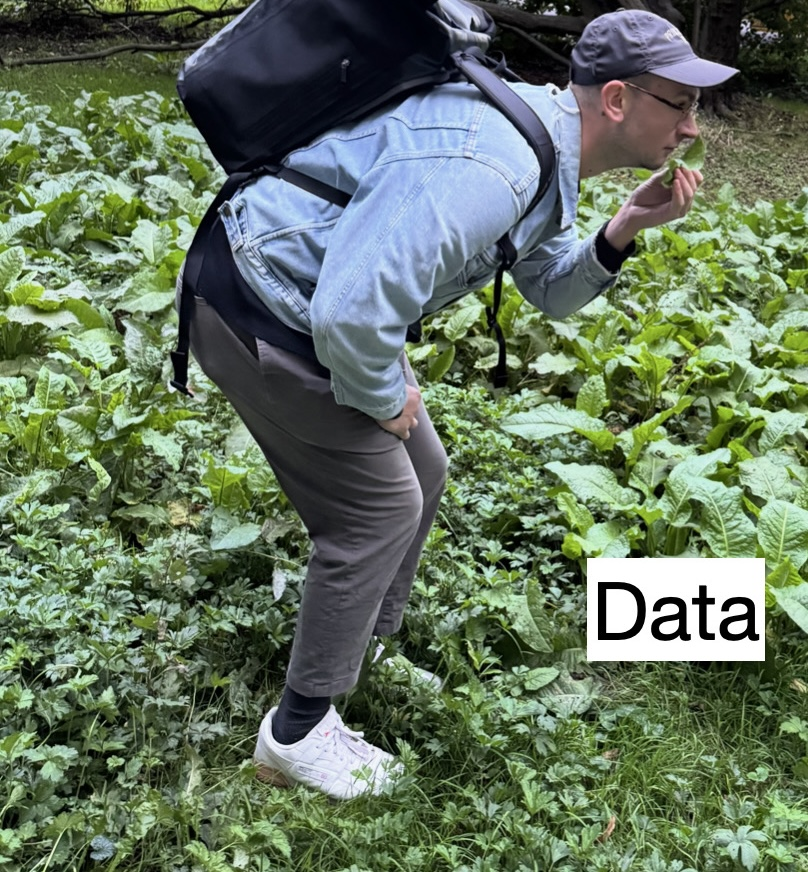

This is a Quarto website for the "Forschungsseminar CSS" course at Leipzig University. It covers different techniques for the aspiring computational social scientist, hence we have dubbed it "Toolbox CSS." The site and original course materials were developed by Felix Lennert, whose work you can explore on [his website](https://felix-lennert.netlify.app). We, [Sascha Grehl](sascha.grehl@uni-leipzig.de) and [Wiebke Krügener](kruegener@studserv.uni-leipzig.de), have now taken over the course and maintain and adapt these materials. Many thanks to Felix for generously sharing his work and supporting the transition. For questions about the course or materials, please contact Sascha!

As Felix’s example shows, putting time and effort into CSS can open doors to exciting opportunities:

| Then | Now |
|:---:|:---:|
| {width="200"} | {width="200"} |
| In the field, harvesting some fresh raw material before transforming it into insights (© Alexandra Gibbons) | From harvesting raw data to cultivating playlists: Thanks for helping us grow, Felix—and all the best for your next chapter at Spotify! |

## The Course

Here's the official description:

> The Forschungsseminar in Computational Social Science (CSS) equips you with the tools to analyze human behavior, predict social trends, and tackle complex societal issues using cutting-edge data science techniques. From web scraping to AI-powered text analysis, you'll learn to use your computer in new ways to gain insights into social phenomena.

The curriculum covers a range of topics including data management, web scraping, speech-to-text, and computational text analysis. Students will hone their R and develop skills in Python, applying these languages to real-world social science problems. The course progresses from fundamental concepts to advanced techniques, including the use of state-of-the-art AI models for text analysis.

The course structure consists of one lecture and one lab session per week, providing a balance of theoretical knowledge and practical application. Throughout the semester, students will benefit from hands-on coding exercises, one-on-one mentoring, and collaborative projects. The course culminates in a research paper, allowing students to apply their new skills to a topic of their choice.

## Course Structure

The course consists of [lectures](lectures-overview.qmd) introducing each week's content and a [course script](1_r_index.qmd) that provides hands-on coding examples for the content. It is mostly containing R with some Python mixed in for good measure when no great R alternatives exist (e.g., for web scraping with Selenium, text classification with `transformer` models).

At the beginning of the course, students are encouraged to form groups based on research interests and general vibes. I require each student group to check in with me at the beginning of each week to report their progress (even if there's nothing to report -- no progress, no problem). This does not count towards any grade but rather serves the purpose of me receiving feedback on the learning experience (this is a new course!) -- and will hopefully help me with providing more appropriate guidance.

Here's an overview of the topics covered:

| SESSION | TITLE | CONTENT | INFORMAL TITLE |
|----------------|----------------|----------------|-------------------------|
| 1 | Kick Off | Housekeeping; Setting up workstation; R recap | Whatever you want to know about CSS |
| 2 | Brief Intro to Python & Regexes | Python basics (`reticulate`, data types, loops, functions, `pandas`); Regular expressions with stringr | REGEXES -- tame your data |
| 3 | Data Acquisition I | How the web is written and ethics; `rvest` web scraping | stealing data from websites without them noticing it |
| 4 | Data Acquisition II | Dynamic pages and forms with `selenium`; APIs with `httr2` | stealing MORE data from websites |
| 5 | Data Acquisition III | Intro to OCR with `tesseract` and transcription (OpenAI Whisper) | making the computer your transcription servant |
| 6 |  |  |  |
| 7 | Student Project Week | Work on projects in class | time to get your hands dirty |
| 8 | Text as Data I | Bag of words; Sentiment analysis, TF-IDF, NER/POS, supervised ML | (advanced) text analysis |
| 9 | Text as Data II | Unsupervised ML (topic modeling); Word Embeddings | finding patterns without labels |
| 10 | Text as Data III | Supervised learning on steroids (BERT) | transformer models |
| 11 | Text as Data IV | transformers for topic modeling (BERTopic) | more transformer models |
| 12 | Text as Data V |  |  |
| 13 | Text as Data VI | LLMs for information extraction |  |
| 14 | Presentation Preparation Week |  | prep your presentation |
| 15 | Presentations & Wrap Up | Peer-reviewed presentations; Course wrap-up | show off your work |

## Syllabus

Please click [here to download the latest version of the syllabus](./syllabus/syllabus_toolboxCSS_winter2627.pdf).

```{css echo=FALSE}
.embed-container {
    position: relative;
    padding-bottom: 129%;
    height: 0;
    overflow: hidden;
    max-width: 100%;
}

.embed-container iframe,
.embed-container object,
.embed-container embed {
    position: absolute;
    top: 0;
    left: 0;
    width: 100%;
    height: 100%;
}
```

Alternatively, read it here (probably not the best if you're visiting this page on a mobile device):

::: embed-container
<iframe src="./syllabus/syllabus_toolboxCSS_winter2627.pdf" style="border: 0.5px">

</iframe>
:::